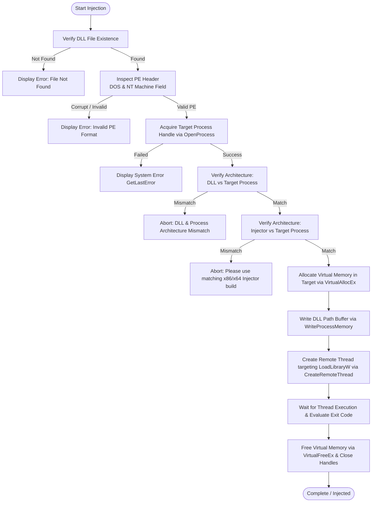

# Native DLL Injector (Modular Edition)

[-0078D6?logo=windows&logoColor=white)](https://github.com)
[](https://isocpp.org/)
[](https://cmake.org/)
[](#)
[](LICENSE)

A high-performance, modular, and lightweight graphical DLL Injector and Ejector designed for Windows operating systems with **Multi-Architecture support (x64 & x86)**. Built using **Modern C++20** and the **Native Win32 API / Common Controls v6**, this tool achieves an ultra-low memory footprint, immediate responsiveness, and zero dependencies on bulky third-party GUI frameworks (such as Qt, .NET, or Electron).

The injector features integrated Portable Executable (PE) header validation, bidirectional architecture verification (Injector vs Process vs DLL), background auto-injection, dynamic module ejection/unloading, and embedded UAC Administrator elevation.

---

## 🌟 Key Features

- **Multi-Architecture Support (x64 & x86)**:
  - Native **x64** build (`injector-x64.exe`) optimized for 64-bit target processes and 64-bit modules.
  - Native **x86** build (`injector-x86.exe`) designed for 32-bit target processes and 32-bit modules.
  - Dual-layer architecture verification: prevents process crashes by verifying compatibility between the DLL, the target process, and the injector binary.
- **100% Native & Ultra-Lightweight**: Built purely with the Win32 API, styled with Common Controls v6 and modern Segoe UI typography. Delivers a compact standalone binary with virtually zero runtime overhead.
- **PE Header Parsing & Bitness Verification**:
  - Automatically parses the DOS Header and PE NT Headers (`IMAGE_NT_HEADERS`) prior to injection.
  - Checks if the selected DLL is corrupted or incompatible with the target process architecture before attempting memory allocation.
- **Safe Remote Thread Injection**:
  - Allocates virtual memory in the target process using `VirtualAllocEx`.
  - Safely writes the DLL path buffer via `WriteProcessMemory`.
  - Invokes `LoadLibraryW` via `CreateRemoteThread`.
  - Monitors the thread exit code via `GetExitCodeThread` to verify successful module mapping.
- **Dynamic Module Ejection / Unloader**:
  - Takes a real-time module snapshot via `CreateToolhelp32Snapshot`.
  - Identifies the module's base handle (`HMODULE`).
  - Safely calls `FreeLibrary` inside a remote thread, unloading the DLL without needing to restart the host application.
- **Smart Auto-Inject**:
  - Powered by a non-blocking background thread (`std::thread`, `std::atomic`).
  - Actively monitors for target process launches by executable name (e.g., `TargetApp.exe`).
  - Automatically executes injection upon detection with an intentional stabilization delay.
- **Ergonomic User Experience**:
  - **Drag-and-Drop**: Drag `.dll` files directly into the injector window.
  - **Real-Time Process Filter**: Instantly search and filter active processes by name or PID.
  - **Local DLL Auto-Discovery**: Automatically scans and lists `.dll` files in the working directory.
  - **File Dialog Browser**: Standard Windows Open File dialog integration.
  - **Configuration Persistence**: Automatically saves and restores the last-used DLL path and process filter via `config.ini`.
  - **Descriptive Error Reporting**: Translates Win32 API error codes into human-readable messages using `FormatMessageW`.

---

## 🔄 Injection Workflow

The diagram below illustrates the validation and injection pipeline:



---

## 📋 System Requirements

- **Operating System**: Windows 10 / Windows 11 (64-bit or 32-bit)
- **Privileges**: Administrator privileges (UAC elevation requested automatically via application manifest)
- **Compiler**: Microsoft Visual C++ (MSVC) with C++20 standard support (Visual Studio 2022 v143 or newer)
- **Build System**: CMake 3.20+ and Ninja or MSBuild

---

## 🛠️ Build & Compilation

### Option 1: Command Line (CMake + Ninja / MSVC)

#### Building for x64 (64-bit)
1. Open the **x64 Native Tools Command Prompt for VS 2022**.
2. Run the build commands:
   ```cmd
   cmake -B build-x64 -G Ninja -DCMAKE_BUILD_TYPE=Release -DCMAKE_CXX_COMPILER=cl
   cmake --build build-x64 --config Release
   ```
   The compiled executable will be at `build-x64/injector-x64.exe`.

#### Building for x86 (32-bit)
1. Open the **x86 Native Tools Command Prompt for VS 2022** (or `x86_x64 Cross Tools Command Prompt`).
2. Run the build commands:
   ```cmd
   cmake -B build-x86 -G Ninja -DCMAKE_BUILD_TYPE=Release -DCMAKE_CXX_COMPILER=cl
   cmake --build build-x86 --config Release
   ```
   The compiled executable will be at `build-x86/injector-x86.exe`.

---

### Option 2: Visual Studio IDE

1. Launch Visual Studio 2022.
2. Select **File** > **Open** > **Folder...** and choose the project directory.
3. Switch the active target architecture configuration between **x64-Release** or **x86-Release**.
4. Press `Ctrl + Shift + B` (or select **Build** > **Build All**) to compile.

---

## 🤖 Automated CI/CD & GitHub Releases

The repository includes a comprehensive GitHub Actions workflow (`.github/workflows/build.yml`) that builds both architectures automatically:

- **Continuous Integration**: On every `push` and `pull_request` to `main` or `master`, the workflow builds both `x64` and `x86` binaries using MSVC and Ninja.
- **Automated GitHub Release on Tag**: When a new tag is pushed (e.g. `git tag v1.1.0 && git push origin v1.1.0`), the workflow automatically:
  1. Compiles both `injector-x64.exe` and `injector-x86.exe`.
  2. Generates individual zip packages: `Native-Injector-x64.zip` and `Native-Injector-x86.zip`.
  3. Bundles both binaries into `Native-Injector-MultiArch.zip`.
  4. Creates a new GitHub Release with release notes and attaches all zip archives automatically.

---

## 🚀 Usage Guide

### 1. Manual Injection
1. Choose the matching injector build:
   - Run `injector-x64.exe` for 64-bit games/applications.
   - Run `injector-x86.exe` for 32-bit games/applications.
2. Select your target DLL:
   - Choose from the drop-down list (if placed in the same directory),
   - Click **Browse...** to navigate your filesystem, or
   - Drag and drop your `.dll` file directly onto the window.
3. Type the target executable name into the **Filter Process** box (e.g., `notepad.exe` or `game.exe`).
4. Select the process from the **Select Process** list.
5. Click **INJECT DLL**.

### 2. Auto-Inject on Process Launch
1. Select or drop your target DLL.
2. Enter the exact executable name into the **Filter Process** field (e.g., `GameClient.exe`).
3. Check the **Auto-Inject upon process detection** checkbox.
4. Launch your target application. The injector will detect the process and inject the DLL automatically.

### 3. Eject / Unload DLL
1. Select the running target process.
2. Ensure the DLL path or filename corresponds to the module you wish to eject.
3. Click **EJECT / UNLOAD**. The module will be cleanly detached from the remote process.

---

## 📁 Project Structure

```text
simple-dll-injector/
├── .github/
│   └── workflows/
│       └── build.yml       # Multi-arch CI/CD and automated GitHub Release workflow
├── .gitignore              # Git ignore rules for build artifacts
├── CMakeLists.txt          # Multi-architecture CMake configuration (x64 / x86, C++20)
├── include/                # Modular Header Definitions
│   ├── config/
│   │   └── config.hpp      # Configuration persistence declarations
│   ├── core/
│   │   ├── auto_inject.hpp # Background auto-injection manager
│   │   └── injector.hpp    # Injection & ejection engine declarations
│   ├── ui/
│   │   └── main_window.hpp # Native Win32 window declarations
│   └── utils/
│       ├── pe_parser.hpp   # PE header validation and architecture parser
│       └── process_utils.hpp # Process enumeration, bitness, and error formatters
├── resources/              # Windows Application Resources
│   ├── app.ico             # Multi-resolution icon (16x16 to 256x256)
│   ├── resource.h          # Resource ID definitions
│   └── resource.rc         # Windows resource script
├── src/                    # Source Implementations
│   ├── config/
│   │   └── config.cpp      # Settings file I/O implementation
│   ├── core/
│   │   ├── auto_inject.cpp # Multi-threaded auto-injection worker
│   │   └── injector.cpp    # Remote thread injection & dynamic ejection
│   ├── ui/
│   │   └── main_window.cpp # Pure Win32 UI controls, events, and layout
│   ├── utils/
│   │   ├── pe_parser.cpp   # PE architecture and signature verification
│   │   └── process_utils.cpp # Toolhelp32 process snapshot routines
│   └── main.cpp            # Application entry point (wWinMain)
└── README.md               # Comprehensive project documentation
```

---

## 🛡️ Disclaimer

> [!WARNING]
> This project is designed, developed, and published strictly for **educational purposes, reverse engineering research, software debugging, and authorized software testing**.
>
> The developers and contributors assume no liability and are not responsible for any misuse, unauthorized modification of third-party software, online cheating, copyright infringement, or violations of third-party Terms of Service (ToS). Please use this tool ethically and responsibly.

---

## 📄 License

Distributed under the [MIT License](LICENSE). Feel free to use, inspect, and customize according to your requirements.
