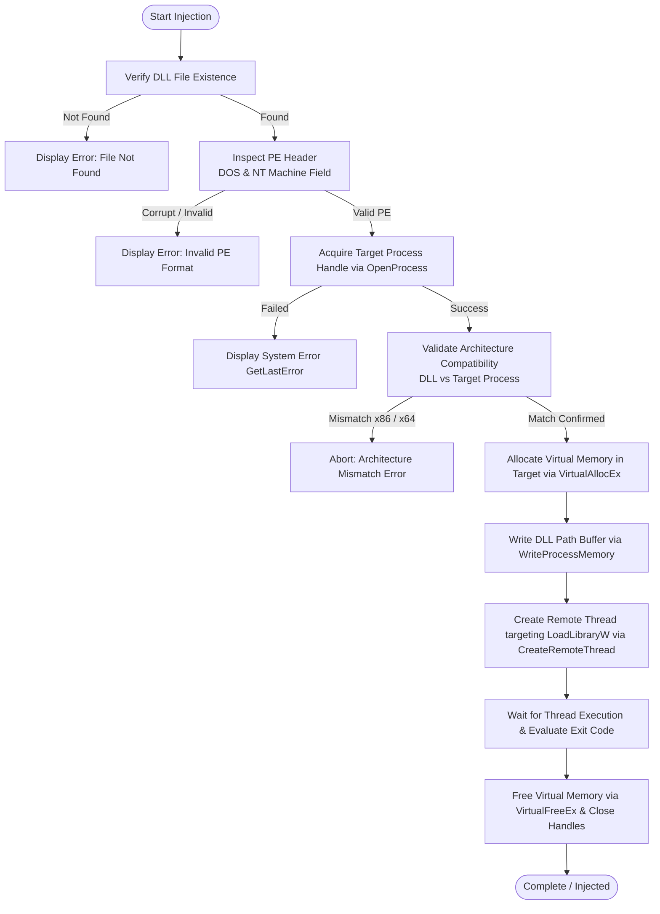

# Native DLL Injector (Modular Edition)

[](https://github.com)
[](https://isocpp.org/)
[](https://cmake.org/)
[](#)
[](LICENSE)

A high-performance, modular, and lightweight graphical DLL Injector and Ejector designed for 64-bit Windows operating systems (x64). Built using **Modern C++20** and the **Native Win32 API / Common Controls v6**, this tool achieves an ultra-low memory footprint, immediate responsiveness, and zero dependencies on bulky third-party GUI frameworks (such as Qt, .NET, or Electron).

The injector features integrated Portable Executable (PE) header validation, automatic architecture verification (x86 vs x64), background auto-injection, dynamic module ejection/unloading, and embedded UAC Administrator elevation.

---

## 🌟 Key Features

- **100% Native & Ultra-Lightweight**: Built purely with the Win32 API, styled with Common Controls v6 and modern Segoe UI typography. Delivers a compact standalone binary with virtually zero runtime overhead.
- **PE Header Parsing & Architecture Validation**:
  - Automatically parses the DOS Header and PE NT Headers (`IMAGE_NT_HEADERS`) prior to injection.
  - Verifies architectural compatibility between the DLL and target process to prevent target crashes caused by mismatched bitness (e.g., attempting to inject 32-bit binaries into 64-bit processes).
- **Safe Remote Thread Injection**:
  - Allocates virtual memory in the target process using `VirtualAllocEx`.
  - Safely writes the DLL path buffer via `WriteProcessMemory`.
  - Invokes `LoadLibraryW` via `CreateRemoteThread`.
  - Monitors the thread exit code via `GetExitCodeThread` to verify successful module mapping.
- **Dynamic Module Ejection / Unloader**:
  - Takes a real-time module snapshot via `CreateToolhelp32Snapshot`.
  - Identifies the module's base handle (`HMODULE`).
  - Safely calls `FreeLibrary` inside a remote thread, unloading the DLL without needing to restart the host application.
- **Smart Auto-Inject**:
  - Powered by a non-blocking background thread (`std::thread`, `std::atomic`).
  - Actively monitors for target process launches by executable name (e.g., `TargetApp.exe`).
  - Automatically executes injection upon detection with an intentional stabilization delay.
- **Ergonomic User Experience**:
  - **Drag-and-Drop**: Drag `.dll` files directly into the injector window.
  - **Real-Time Process Filter**: Instantly search and filter active processes by name or PID.
  - **Local DLL Auto-Discovery**: Automatically scans and lists `.dll` files in the working directory.
  - **File Dialog Browser**: Standard Windows Open File dialog integration.
  - **Configuration Persistence**: Automatically saves and restores the last-used DLL path and process filter via `config.ini`.
  - **Descriptive Error Reporting**: Translates Win32 API error codes into human-readable messages using `FormatMessageW`.

---

## 🔄 Injection Workflow

The diagram below illustrates the validation and injection pipeline:



---

## 📋 System Requirements

- **Operating System**: Windows 10 / Windows 11 (64-bit / x64)
- **Privileges**: Administrator privileges (UAC elevation requested automatically via application manifest)
- **Compiler**: Microsoft Visual C++ (MSVC) with C++20 standard support (Visual Studio 2022 v143 or newer)
- **Build System**: CMake 3.20+ and Ninja or MSBuild

---

## 🛠️ Build & Compilation

### Option 1: Command Line (CMake + Ninja / MSVC)

1. Open the **x64 Native Tools Command Prompt for VS 2022**.
2. Clone or navigate to the project directory:
   ```cmd
   git clone https://github.com/username/simple-dll-injector.git
   cd simple-dll-injector
   ```
3. Configure the build directory:
   ```cmd
   cmake -B build -G Ninja -DCMAKE_BUILD_TYPE=Release -DCMAKE_CXX_COMPILER=cl
   ```
4. Build the executable:
   ```cmd
   cmake --build build --config Release
   ```
5. The compiled executable will be located at `build/injector.exe`.

---

### Option 2: Visual Studio IDE

1. Launch Visual Studio 2022.
2. Select **File** > **Open** > **Folder...** and choose the project root.
3. Set the active configuration preset/architecture to **x64-Release**.
4. Press `Ctrl + Shift + B` (or select **Build** > **Build All**) to compile.

---

## 🚀 Usage Guide

### 1. Manual Injection
1. Run `injector.exe` as Administrator.
2. Select your target DLL:
   - Choose from the drop-down list (if the DLL is placed in the same directory),
   - Click **Browse...** to navigate your filesystem, or
   - Simply drag and drop your `.dll` file directly onto the injector window.
3. Type the target executable name into the **Filter Process** box (e.g., `notepad.exe` or `game.exe`).
4. Select the process from the **Select Process** list.
5. Click **INJECT DLL**.

### 2. Auto-Inject on Process Launch
1. Select or drop your target DLL.
2. Enter the exact executable name into the **Filter Process** field (e.g., `GameClient.exe`).
3. Check the **Auto-Inject upon process detection** checkbox.
4. Launch your target application. The injector will detect the process and inject the DLL automatically.

### 3. Eject / Unload DLL
1. Select the running target process.
2. Ensure the DLL path or filename corresponds to the module you wish to eject.
3. Click **EJECT / UNLOAD**. The module will be cleanly detached from the remote process.

---

## 📁 Project Structure

```text
simple-dll-injector/
├── .github/
│   └── workflows/
│       └── build.yml       # Automated CI/CD workflow (x64 MSVC + Ninja)
├── .gitignore              # Git ignore rules for build artifacts
├── CMakeLists.txt          # Modern CMake configuration (C++20, x64 check, Win32 manifest)
├── include/                # Modular Header Definitions
│   ├── config/
│   │   └── config.hpp      # Configuration persistence declarations
│   ├── core/
│   │   ├── auto_inject.hpp # Background auto-injection manager
│   │   └── injector.hpp    # Injection & ejection engine declarations
│   ├── ui/
│   │   └── main_window.hpp # Native Win32 window declarations
│   └── utils/
│       ├── pe_parser.hpp   # PE header validation and architecture parser
│       └── process_utils.hpp # Process enumeration and error formatters
├── src/                    # Source Implementations
│   ├── config/
│   │   └── config.cpp      # Settings file I/O implementation
│   ├── core/
│   │   ├── auto_inject.cpp # Multi-threaded auto-injection worker
│   │   └── injector.cpp    # Remote thread injection & dynamic ejection
│   ├── ui/
│   │   └── main_window.cpp # Pure Win32 UI controls, events, and layout
│   ├── utils/
│   │   ├── pe_parser.cpp   # PE architecture and signature verification
│   │   └── process_utils.cpp # Toolhelp32 process snapshot routines
│   └── main.cpp            # Application entry point (wWinMain)
└── README.md               # Comprehensive project documentation
```

---

## 🛡️ Disclaimer

> [!WARNING]
> This project is designed, developed, and published strictly for **educational purposes, reverse engineering research, software debugging, and authorized software testing**.
>
> The developers and contributors assume no liability and are not responsible for any misuse, unauthorized modification of third-party software, online cheating, copyright infringement, or violations of third-party Terms of Service (ToS). Please use this tool ethically and responsibly.

---

## 📄 License

Distributed under the [MIT License](LICENSE). Feel free to use, inspect, and customize according to your requirements.
