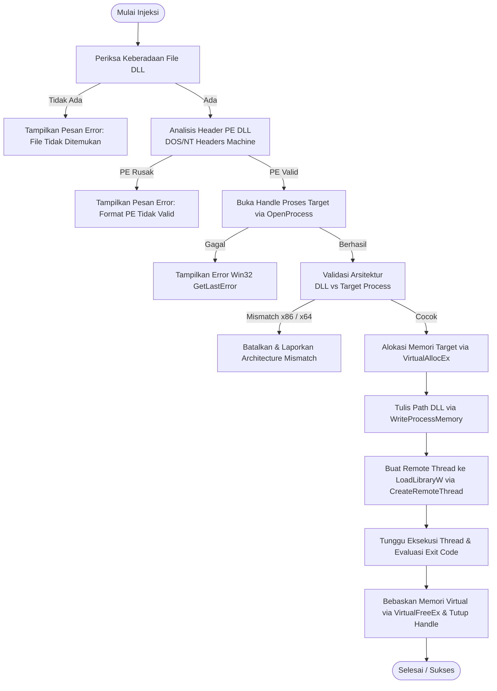

# Native DLL Injector (Modular Edition)

[](https://github.com)
[](https://isocpp.org/)
[](https://cmake.org/)
[](#)
[](LICENSE)

Aplikasi GUI DLL Injector dan Ejector modular berkinerja tinggi untuk sistem operasi Windows 64-bit (x64). Dikembangkan menggunakan standar **Modern C++20** dan **Native Win32 API / Common Controls v6**, menghasilkan *footprint* memori minimal, kecepatan respons tinggi, dan tanpa dependensi framework eksternal yang berat (seperti Qt, .NET, atau Electron).

Dilengkapi dengan validasi header Portable Executable (PE), pendeteksi kesesuaian arsitektur (x86 vs x64), fitur *auto-inject*, *ejection/unloading* modul dinamis, serta integrasi UAC Administrator.

---

## 🌟 Fitur Utama

- **100% Native & Ultra-Lightweight**: Menggunakan Win32 API murni dengan visual style Common Controls v6 dan tipografi Segoe UI. Ukuran file executable sangat ringkas dengan konsumsi resource yang sangat rendah.
- **Validasi Header PE & Deteksi Arsitektur**:
  - Membaca dan memvalidasi *DOS Header* & *PE NT Headers* sebelum injeksi dijalankan.
  - Memeriksa kesesuaian arsitektur antara DLL dan target process (mencegah *crash* akibat menginjeksi DLL arsitektur silang, misalnya 32-bit ke 64-bit).
- **Injeksi Aman (Remote Thread Injection)**:
  - Alokasi memori virtual di target proses melalui `VirtualAllocEx`.
  - Penulisan buffer path DLL via `WriteProcessMemory`.
  - Eksekusi aman `LoadLibraryW` menggunakan `CreateRemoteThread`.
  - Monitoring thread exit code untuk memastikan modul berhasil di-*load*.
- **Modul Ejection / Dynamic Unloader**:
  - Mengambil snapshot modul target secara *real-time* via `CreateToolhelp32Snapshot`.
  - Mencari *base handle* modul spesifik.
  - Melepaskan (*unload*) modul dari proses target menggunakan panggilan remote `FreeLibrary` tanpa perlu me-restart aplikasi target.
- **Auto-Inject Cerdas**:
  - Dijalankan pada thread latar belakang (`std::thread` & `std::atomic`).
  - Memantau siklus hidup proses berdasarkan nama file eksekutabel (contoh: `target_app.exe`).
  - Menginjeksi secara otomatis segera setelah proses target muncul dengan jeda stabilisasi.
- **User Experience (UX) Ergonomis**:
  - **Drag-and-Drop**: Tarik file `.dll` langsung ke jendela aplikasi.
  - **Filter & Search Real-Time**: Pencarian cepat daftar proses berdasarkan nama file atau kata kunci.
  - **Auto-Discovery DLL**: Otomatis mendeteksi file `.dll` yang berada di direktori kerja aplikasi.
  - **File Dialog Browser**: Kemudahan navigasi file melalui Windows Open File Dialog standar.
  - **State Persistence**: Mengingat path DLL dan filter proses terakhir yang disimpan ke dalam file konfigurasi lokal `config.ini`.
  - **Deskripsi Error Informatif**: Integrasi `FormatMessageW` untuk menerjemahkan kode error Win32 API menjadi pesan deskriptif.

---

## 🔄 Alur Kerja Injeksi

Berikut adalah alur logika yang diterapkan sebelum dan saat injeksi dilakukan:



---

## 📋 Persyaratan Sistem

- **Sistem Operasi**: Windows 10 / Windows 11 (64-bit / x64)
- **Hak Akses**: Hak Administrator (*Privileged UAC* diminta secara otomatis melalui manifest)
- **Compiler**: Microsoft Visual C++ (MSVC) dengan dukungan C++20 (Visual Studio 2022 v143 atau lebih baru)
- **Build System**: CMake versi 3.20 ke atas dan Ninja / MSBuild

---

## 🛠️ Panduan Build & Kompilasi

### Opsi 1: Kompilasi via Command Line (CMake + Ninja / MSVC)

1. Buka terminal **x64 Native Tools Command Prompt for VS 2022**.
2. Clone atau buka direktori proyek ini:
   ```cmd
   git clone https://github.com/username/simple-dll-injector.git
   cd simple-dll-injector
   ```
3. Lakukan konfigurasi build:
   ```cmd
   cmake -B build -G Ninja -DCMAKE_BUILD_TYPE=Release -DCMAKE_CXX_COMPILER=cl
   ```
4. Jalankan kompilasi:
   ```cmd
   cmake --build build --config Release
   ```
5. File eksekutabel hasil kompilasi akan berada di folder `build/injector.exe`.

---

### Opsi 2: Visual Studio IDE

1. Buka Visual Studio 2022.
2. Pilih menu **File** > **Open** > **Folder...** dan arahkan ke direktori proyek ini.
3. Pastikan konfigurasi arsitektur aktif disetel ke **x64-Release**.
4. Tekan tombol **Build All** (`Ctrl + Shift + B`).

---

## 🚀 Panduan Penggunaan

### 1. Injeksi Manual
1. Jalankan `injector.exe` dengan hak Administrator.
2. Tentukan target DLL:
   - Pilih dari *dropdown* (jika DLL berada di folder yang sama), atau
   - Klik tombol **Browse...**, atau
   - Cukup seret (*drag-and-drop*) file `.dll` Anda ke jendela injector.
3. Ketik nama proses pada kolom **Filter Proses** (misalnya `notepad.exe` atau `game.exe`).
4. Pilih proses dari *dropdown* **Pilih Proses**.
5. Klik tombol **INJECT DLL**.

### 2. Auto-Inject Saat Proses Diluncurkan
1. Tentukan target DLL Anda.
2. Ketik nama lengkap file proses pada kolom **Filter Proses** (contoh: `GameClient.exe`).
3. Berikan centang pada kotak **Auto-Inject saat proses terdeteksi**.
4. Jalankan aplikasi/game target Anda. Injector akan mendeteksi proses secara otomatis dan menginjeksi DLL dalam hitungan detik.

### 3. Eject / Melepaskan DLL
1. Pilih proses target yang sedang aktif.
2. Pastikan path atau nama DLL sesuai dengan modul yang ingin dilepaskan.
3. Klik tombol **EJECT / UNLOAD**. Modul akan di-*unload* dari proses secara dinamis.

---

## 📁 Struktur Proyek

```text
simple-dll-injector/
├── .github/
│   └── workflows/
│       └── build.yml       # Otomatisasi CI/CD GitHub Actions (x64 MSVC + Ninja)
├── .gitignore              # Konfigurasi ignoransi file build/artefak
├── CMakeLists.txt          # Skrip build CMake modern (C++20, x64 check, Win32 manifest)
├── injector.cpp            # Kode sumber utama GUI Win32, PE parser, Injeksi & Ejeksi
└── README.md               # Dokumentasi proyek
```

---

## 🛡️ Keamanan & Penafian (Disclaimer)

> [!WARNING]
> Proyek ini dibuat dan dipublikasikan semata-mata untuk **tujuan edukasi, penelitian keamanan perangkat lunak (*security research*), *software debugging*, dan modifikasi perangkat lunak secara sah**.
>
> Pengembang tidak bertanggung jawab atas penyalahgunaan aplikasi ini untuk aktivitas terlarang, kecurangan daring (*online game cheating*), pelanggaran hak cipta, atau aktivitas yang melanggar *Terms of Service* (ToS) dari perangkat lunak pihak ketiga. Gunakan secara bijak dan bertanggung jawab.

---

## 📄 Lisensi

Didistribusikan di bawah lisensi [MIT](LICENSE). Silakan gunakan, pelajari, dan kembangkan sesuai dengan kebutuhan Anda.
